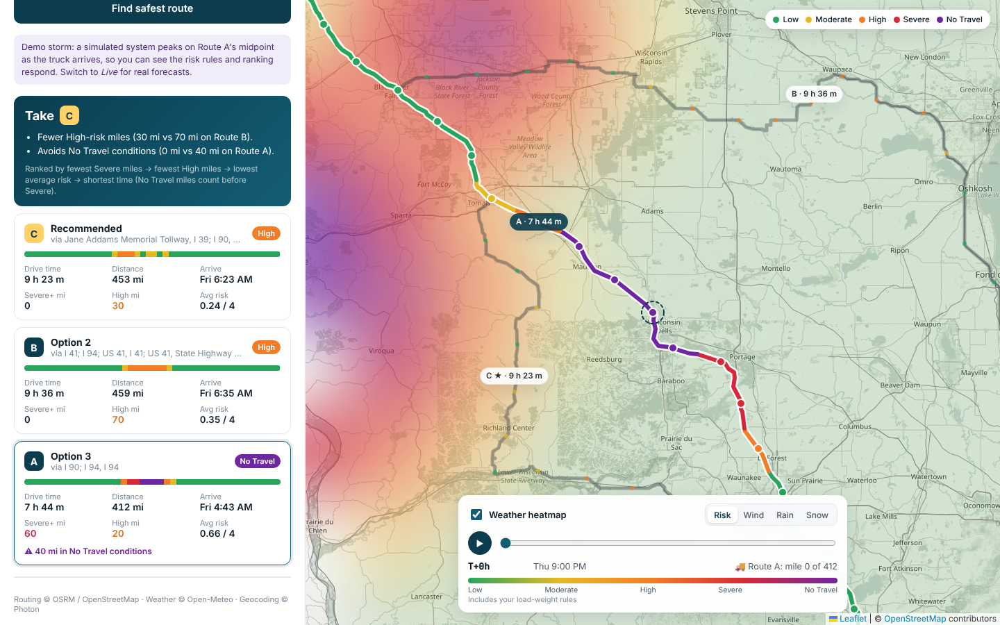

# Weather-Aware Truck Routing

A React + Django app that helps a truck driver pick the safest route. It builds three route
options, forecasts the weather **at the moment the truck will reach each checkpoint**, classifies
risk with the provided wind/rain/snow and load-weight rules, and recommends a route by
weather risk first and travel time second. A corridor heatmap with a 0–48 h slider shows how
the weather evolves around the trip.

- **Live app:** https://weather-truck-routing-weld.vercel.app
- **Walkthrough (Loom):** https://www.loom.com/share/e695959802f0412481bfaf30b517dec6



---

## Features

| Requirement | Where it lives |
| --- | --- |
| Origin, destination, departure, load weight | `TripForm` (place autocomplete, local-time departure, lb) |
| 3 route options from a routing API | `services/routing.py` — OSRM alternatives, topped up with via-point detours |
| Weather every 10 / 25 / 50 mi at the truck's ETA | `services/checkpoints.py` + `services/weather.py` |
| Risk from the provided rules | `services/risk.py` (single source of truth, fully unit-tested) |
| Recommendation balancing risk and time | `services/recommend.py` |
| Routes, checkpoints, risk, ETAs, summaries on a map | `MapView`, `RouteCards`, `CheckpointTable` |
| Corridor heatmap with 0–48 h slider | `services/heatmap.py` + `lib/heatmap.ts` + `TimeControl` |

## How it works

```
React (Vite, Leaflet)                     Django REST API                      Third-party
──────────────────────                    ───────────────                      ───────────
TripForm ──POST /api/plan/──────────────▶ geocode (if no coords) ───────────▶ Photon → Open-Meteo geocoder
                                           routes ──────────────────────────▶ OSRM
                                           truck timing + checkpoints
                                           batched hourly forecasts ────────▶ Open-Meteo (cached)
                                           risk → summaries → ranking
          ◀──── routes, checkpoints, ETAs, risk segments, recommendation
TimeControl ─POST /api/heatmap/─────────▶ corridor grid → forecasts (cached) ─▶ Open-Meteo
          ◀──── 49 hourly frames × 4 layers
```

### 1. Routes
OSRM's public server is queried with `alternatives=3`. It often returns fewer than three, so the
remaining options are generated by routing through a **via-point pushed sideways** off the
fastest route (at the middle and the thirds, 12–22 % of the trip length to each side). A candidate
is rejected if it:
- overlaps an accepted route by more than 80 % (in either direction),
- is more than 1.6× the fastest route's distance or time, or
- contains an out-and-back spur (the path revisits a spot it left 3+ km earlier).

If the road network genuinely offers fewer than three sensible options, the app says so instead
of padding with junk routes.

### 2. Truck timing and checkpoints
OSRM's per-segment durations are for cars. Each segment is slowed to a **65 mph truck governor**
(configurable) wherever the car would be faster — urban segments keep their slower times.
Checkpoints are placed at mile 0, every 10/25/50 miles, and at the destination; each carries its
ETA. Each checkpoint **represents the road halfway back to the previous one and halfway on to the
next**, so represented miles add up exactly to the route length — that's what "Severe miles"
are counted from.

### 3. Weather at the ETA
Open-Meteo's hourly forecast is fetched for all checkpoints of all routes in batched,
multi-location requests (shared start/end points are fetched once; results are cached for 30 min
in a cache shared by all workers). Units are requested in mph / inches and normalised defensively.
At an ETA *t*:
- **wind** is linearly interpolated between the surrounding hours (an instantaneous value);
- **rain** (`rain` + `showers`) and **snow** (`snowfall`) are hourly totals for the preceding
  hour, so the hour that contains *t* is used directly as the in/hr rate.

Checkpoints beyond the forecast horizon are shown as *unknown* and excluded from averages.

### 4. Risk rules
Each checkpoint's level is the worst of its wind, rain and snow levels:

| | Low | Moderate | High | Severe | No Travel |
|---|---|---|---|---|---|
| Wind (mph) | < 25 | 25 – <35 | 35 – <45 | 45 – <55 | ≥ 55 |
| Rain (in/hr) | < 0.10 | 0.10 – <0.25 | 0.25 – <0.50 | 0.50 – 1.00 | > 1.00 |
| Snow (in/hr) | < 0.5 | 0.5 – <1.0 | 1.0 – <2.0 | 2.0 – 3.0 | > 3.0 |

Load rules raise the **wind** level: ≥ 55 mph → No Travel for any load; 45–54 mph with
> 30,000 lb → No Travel; 35–44 mph with > 40,000 lb → Severe.

*Boundary decision:* the brief's ranges share edges (e.g. rain 0.10–0.25 and 0.25–0.50), so each
band includes its lower edge; where the brief uses a strict `>` for No Travel (rain > 1.00,
snow > 3.0) the Severe band keeps its upper edge. Every edge is covered by a test.

### 5. Recommendation
Routes are ranked lexicographically by the brief's preference order, with one addition:

1. **Fewest No Travel miles** — No Travel is worse than Severe, so it is checked first
2. Fewest Severe miles
3. Fewest High miles
4. Lowest average risk (distance-weighted, 0 = Low … 4 = No Travel)
5. Shortest travel time

Mile comparisons use a 1-mile tolerance (average risk: 0.02) so rounding noise can't override a
real travel-time difference. The UI explains the pick by naming the criterion that decided each
head-to-head ("Fewer High-risk miles (30 mi vs 70 mi on Route B)"). If every route crosses No
Travel conditions, the app says so and suggests delaying departure.

### 6. Heatmap
The corridor (60 km either side of every route) is covered by a grid that is **square in Web
Mercator**, so each hourly frame can be drawn as a tiny image and stretched by a Leaflet
`ImageOverlay` with no distortion. The cell size grows until at most 180 points need a forecast.
The server returns 49 hourly frames for four layers (risk incl. load rules, wind, rain, snow).
The client renders frames on demand, **blends between hours in 15-minute steps** and caches them,
so dragging or playing the slider is smooth. A truck marker shows where the selected route's
truck is at the slider time.

### Demo storm mode
Real weather is often calm, which makes the risk logic invisible in a demo. **Demo storm**
swaps the forecast for a deterministic, clearly labelled simulated system: a wind/rain cell
that drifts east and peaks on Route A's midpoint exactly when the truck arrives, plus a
smaller snow squall. Everything downstream (ETAs, rules, ranking, heatmap) is the same code.
The app never silently falls back to simulated data — if the live API fails, you get an error.

## API

| Method | Path | Body / query | Returns |
|---|---|---|---|
| GET | `/api/health/` | | `{status}` |
| GET | `/api/geocode/?q=` | | `{results: [{label, lat, lon}]}` |
| POST | `/api/plan/` | `origin`, `destination` (`{query, lat?, lon?}`), `departure` (ISO), `load_weight_lb`, `sample_interval_mi` (10/25/50), `weather_source` (`live`/`simulated`) | routes, checkpoints, summaries, recommendation |
| POST | `/api/heatmap/` | `paths`, `departure`, `load_weight_lb`, `weather_source`, `simulation?` | grid bounds, cells, 49 frames × 4 layers |

The heatmap endpoint is stateless — the client sends back simplified route paths — so it scales
horizontally with no session store.

## Running locally

Requirements: Python 3.11+, Node 20+.

```bash
# API
cd backend
python -m venv .venv && source .venv/bin/activate
pip install -r requirements.txt
python manage.py runserver            # http://127.0.0.1:8000

# UI (second terminal)
cd frontend
npm install
npm run dev                           # http://localhost:5173 (proxies /api to :8000)
```

Tests (43 tests: thresholds and every band edge, load rules, checkpoint spacing/ETAs, forecast
interpolation and unit parsing, ranking order and tolerances, route generation, end-to-end API):

```bash
cd backend && python manage.py test trips
```

## Deployment

The `Dockerfile` builds the React app and serves it from Django (WhiteNoise + gunicorn), so the
whole app is one service.

**Render:** push to GitHub → Render → *New → Blueprint* → pick the repo (`render.yaml` does the
rest). Or `docker build -t truck-routing . && docker run -p 8000:8000 truck-routing`.

**Vercel (no Docker):** import the repo in Vercel; `vercel.json` builds the React app as static files
and runs the Django API as one Python function (`api/index.py`) behind `/api/*`. No environment
variables are required.

Environment variables are listed in `.env.example`. On free hosting the shared outbound IP can hit
Open-Meteo's free daily limit; setting `OPEN_METEO_API_KEY` switches to the commercial endpoint.

## Project layout

```
backend/
  config/            settings (env-driven), urls, wsgi
  trips/
    services/
      geo.py         haversine, polyline resampling, RDP simplification, Mercator, overlap checks
      routing.py     OSRM client + distinct-alternative generation
      checkpoints.py truck timing profile, checkpoint sampling with ETAs
      weather.py     Open-Meteo client (batched, cached), ETA interpolation, simulated storm
      risk.py        the risk and load rules
      recommend.py   route summaries, ranking, explanations
      heatmap.py     corridor grid and hourly frames
      planner.py     orchestration for /api/plan
    serializers.py   request validation
    views.py         thin HTTP layer with error mapping
    tests/           unit + API tests with fake router/weather
frontend/src/
  components/        TripForm, PlaceInput, RouteCards, CheckpointTable, MapView, TimeControl
  lib/               api client, types, risk palette/formatting, heatmap frame rendering
```

## Assumptions and limitations

- **Routing** uses OSRM's car profile with a truck speed cap. It does not know truck
  restrictions (bridge heights, hazmat, weight limits). A truck-aware router (e.g.
  OpenRouteService `driving-hgv`) would slot in behind the same `Router` interface.
- **Hours of service** (11 h driving, mandatory breaks) are not modelled; on multi-day trips
  real ETAs would be later than shown.
- **Wind** uses sustained 10 m wind speed for classification; gusts are displayed for context.
- Departure is limited to the next 14 days so every checkpoint falls inside the 16-day forecast.
- Free public APIs (OSRM demo server, Open-Meteo, Photon, OSM tiles) have fair-use limits; all
  URLs are configurable for self-hosted or paid instances.

## Credits
Routing © OSRM / OpenStreetMap contributors · Weather © Open-Meteo (CC BY 4.0) · Geocoding ©
Photon by Komoot · Map tiles © OpenStreetMap contributors.
